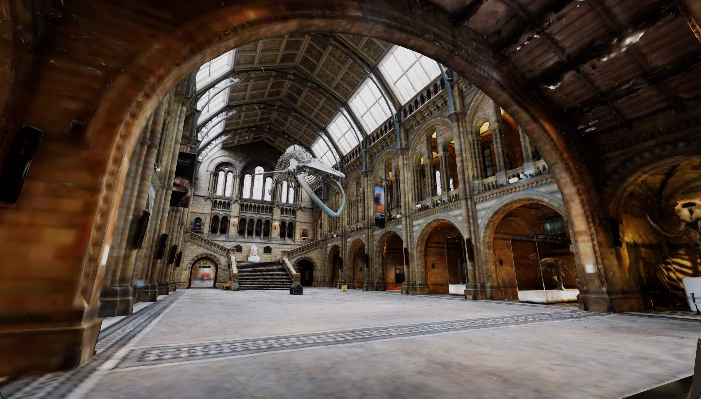

<div align="center">

# Hintze Hall

**Walk through a photogrammetry scan of the Natural History Museum's central hall — in your browser.**

[](https://three-studio.github.io/demo-hintze-hall/)
[](https://github.com/three-studio/three-studio)
[](https://threejs.org)
[](https://rapier.rs)
[](https://www.w3.org/TR/webgpu/)
[](https://creativecommons.org/licenses/by/4.0/)
[](LICENSE)

### [▶ &nbsp;Play the demo](https://three-studio.github.io/demo-hintze-hall/)



</div>

---

## ✨ What is this?

A **static web build exported from [Three Studio](https://github.com/three-studio/three-studio)** — a
desktop 3D game editor built on Three.js, React and Electron.

There is no server, no build step and nothing to install: **the folder in this repository *is* the
site**. It was exported from the editor with *Package for web*, committed as-is, and GitHub Pages
serves it. That round trip — editor → static folder → live URL — is exactly what this demo is here to
show.

What you get is a first-person walkthrough of [Hintze Hall](https://www.nhm.ac.uk/visit/galleries-and-museum-map/hintze-hall.html),
the central hall of the Natural History Museum in London, with *Hope* the blue whale overhead —
a ~2 million triangle photogrammetry scan, with Rapier physics so you actually collide with the floor
and the staircase.

## ▶ Play

**https://three-studio.github.io/demo-hintze-hall/**

First load pulls about **31 MB** (26 MB of it is the scan) and then it is cached — so give it a
moment on a cold visit. The page opens on a **Play** button rather than starting by itself: pointer
lock and the audio context both need a real user gesture, so a build that started cold would just
fail silently.

Press `Esc` at any point to get your cursor back.

## ⌨️ Controls

| Input | Action |
| --- | --- |
| `W` `A` `S` `D` or arrow keys | Move |
| Mouse | Look |
| `Shift` | Sprint (×1.8) |
| `Space` | Jump |
| `Esc` | Release the cursor |

## 🖥️ Requirements

|  |  |
| --- | --- |
| **Browser** | Any current desktop browser — Chrome, Edge, Firefox, Safari |
| **Renderer** | WebGPU where available, automatic **WebGL2 fallback** everywhere else |
| **Pointer Lock** | Required for mouse look |
| **Download** | ~31 MB on first visit, cached afterwards |
| **Mobile** | **Not supported.** The player binds keyboard and mouse only — there are no touch controls, so phones and tablets will load the hall and then leave you standing still |

## 📦 What's in here

```
.
├── index.html                          the page — canvas, click-to-start overlay,
│                                       and <base href="/demo-hintze-hall/">
├── build.json                          the first thing the player fetches: render settings,
│                                       the scene list and the asset table
├── scenes/
│   └── g3hts8fKiM1V.json                the scene — entities, transforms, components, environment
├── assets/
│   └── models/test/
│       └── hintze_hall.1f811041.glb     26 MB — the scan, meshopt-compressed and quantized
├── _studio/
│   └── index-DrV2Smy7.js                4.1 MB — the Three Studio web player: three.js, Rapier
│                                       (its wasm inlined), the ECS runtime and the script host
├── files.json                          size + sha256 for every file above, written by the exporter.
│                                       An integrity manifest — the runtime never reads it
├── favicon.svg                         a real file, so the build does not 404 on /favicon.ico
├── preview.jpg                         the screenshot at the top of this README
└── .nojekyll                           ← do not delete, see below
```

Everything except `README.md`, `LICENSE`, `preview.jpg` and the dotfiles is **generated output**.
Editing `index.html` or `build.json` by hand will be undone by the next export — and `files.json`
records a sha256 per file, so a hand-edit desyncs it. Change the scene in the editor and re-export
instead.

> ### Why `.nojekyll` matters here
>
> GitHub Pages runs **Jekyll** by default, and Jekyll **excludes every path starting with an
> underscore** — including `_studio/`, which holds the only script tag on the page. Without an empty
> `.nojekyll` file at the root, the site deploys happily, loads, 404s on its own player and shows a
> black screen with nothing useful in the UI.
>
> For the same reason, **the model must not go into Git LFS**: branch-based Pages serves LFS pointer
> files verbatim, so the 26 MB scan would arrive as a 130-byte text file. At 26 MB it is well under
> GitHub's limits — plain git is the right answer.

## 🎮 How the scene is set up

|  |  |
| --- | --- |
| **Player** | `playerController` in `fps` mode — 6 m/s, ×1.8 sprint, 1.2 m jump, 1.5 m eye height |
| **Player body** | Capsule collider (r 0.5, half-height 0.5) on a kinematic-position rigidbody |
| **The hall** | Trimesh collider on a fixed rigidbody — the geometry itself is what you walk on |
| **Scale** | The scan is uniformly scaled ×2.90 to bring the room to real-world metres |
| **Rendering** | Shadows at 2048, antialiasing, max pixel ratio 2, mesh batching, exposure 1 |

## 🔧 Run it locally

One catch: `index.html` pins `<base href="/demo-hintze-hall/">`, so serving **this** folder at `/`
resolves every URL one level too high and nothing loads. Serve the **parent** directory instead:

```bash
cd ..
npx serve
# then open http://localhost:3000/demo-hintze-hall/
```

To host it at some other address, don't edit the `<base>` tag — re-export from Three Studio with a
different **Base URL** (leave it empty and every URL stays relative, which works at any address that
ends in a slash).

## 🏗️ How it was made

1. Import the `.glb` into a Three Studio project — *Generate colliders* on, up axis `Z`.
2. Drop it in the scene, scale it to metres, give it a **fixed rigidbody** + **trimesh collider**.
3. Add a capsule with a **kinematic-position rigidbody**, a **capsule collider** and a
   **`playerController`** in `fps` mode. That is the whole player.
4. **Play** in the editor to check the collisions and the walk speed.
5. *Export ▸ Package for web*, Base URL `/demo-hintze-hall/`.
6. Commit the output folder, add `.nojekyll`, push, point GitHub Pages at `main` / `root`.

## 🙏 Credits

The 3D model is **not** mine and is used under a licence that requires attribution:

> **"Hintze Hall"** by **[artfletch](https://sketchfab.com/artfletch)** — licensed under
> **[CC BY 4.0](https://creativecommons.org/licenses/by/4.0/)**.
> [Fab listing](https://www.fab.com/listings/20603de9-37ed-4d9a-a872-f7f851b11a0a) ·
> [original on Sketchfab](https://sketchfab.com/3d-models/hintze-hall-45f5e56887f44075bbf283977c99541f)

Photogrammetry from 3 284 photographs taken in March 2023 with a Sony a7R III and processed in
RealityCapture. The room itself is
[Hintze Hall](https://www.nhm.ac.uk/visit/galleries-and-museum-map/hintze-hall.html) at the
[Natural History Museum, London](https://www.nhm.ac.uk/), a
[Grade I listed](https://historicengland.org.uk/listing/the-list/list-entry/1080675) building by
Alfred Waterhouse.

## 📄 License

| What | License |
| --- | --- |
| This repository's own files (page, scene, build config, docs) | [MIT](LICENSE) |
| `assets/models/test/hintze_hall.1f811041.glb` | [CC BY 4.0](https://creativecommons.org/licenses/by/4.0/) — © artfletch, **not** covered by the MIT licence |
| `_studio/` — the web player | [MIT](https://github.com/three-studio/three-studio), from Three Studio |
| Bundled inside the player | [three.js](https://threejs.org) (MIT), [Rapier](https://rapier.rs) (Apache-2.0) |

---

<div align="center">
<sub>Built with <a href="https://github.com/three-studio/three-studio">Three Studio</a> · Three.js · Rapier · WebGPU</sub>
</div>
